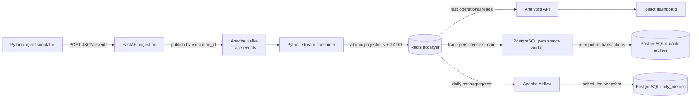
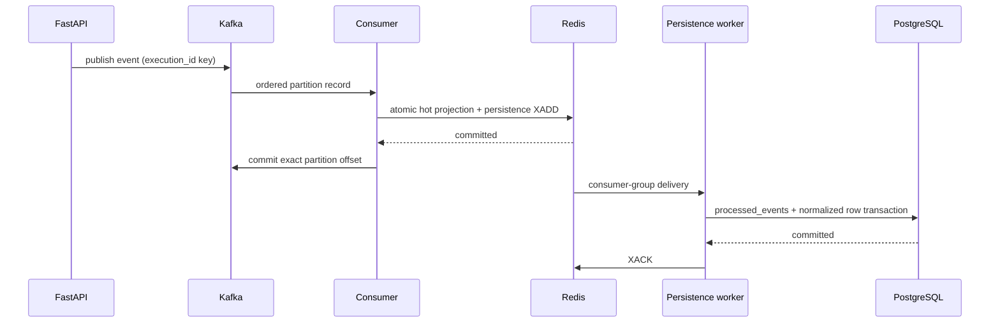

# TraceAI

TraceAI is an event-driven observability platform for simulated AI-agent executions. It records execution lifecycles, tool calls, LLM usage, memory access, errors, latency, tokens, and estimated cost, then exposes those signals through a compact operations dashboard.

The project is intentionally a data-engineering system—not an AI-agent framework. A deterministic simulator supplies realistic telemetry so the ingestion, streaming, hot storage, durable storage, scheduled processing, and analytical retrieval paths can be demonstrated independently.

## Implemented architecture



Redis and PostgreSQL do not connect to one another directly. Application workers coordinate the movement: Redis serves low-latency operational writes and reads, while the persistence worker and Airflow create durable PostgreSQL records.

## Data delivery guarantees



- Kafka offsets are acknowledged only after the Redis transaction succeeds.
- A per-event Redis key prevents hot metrics from double-counting ordinary redeliveries.
- `processed_events.event_id` gives PostgreSQL a second idempotency boundary.
- Redis Streams consumer groups retain unacknowledged archive work; idle pending entries are reclaimed after 60 seconds.
- Redis append-only persistence is enabled for the local lab environment.
- PostgreSQL remains the durable relational record and can rebuild Redis projections in a future recovery utility.

## Repository structure

```text
traceai/
├── airflow/
│   ├── dags/traceai_daily_metrics.py  Redis-to-PostgreSQL daily snapshot
│   └── Dockerfile
├── backend/
│   └── app/                           FastAPI ingestion and Redis analytics
├── consumer/                          Kafka-to-Redis hot projection worker
├── persistence/                       Redis Stream-to-PostgreSQL archive worker
├── database/init/                     Relational schema and Airflow DB bootstrap
├── dashboard/                         React, TypeScript, and nginx frontend
├── shared/traceai_contracts/          Shared discriminated event models
├── simulator/                         Seeded concurrent workload generator
├── tests/                             Contract and simulator tests
├── docker-compose.yml
└── README.md
```

## Services

| Service | Address | Responsibility |
|---|---|---|
| Dashboard | [localhost:3000](http://localhost:3000) | Operational charts and tables |
| TraceAI API | [localhost:8000/docs](http://localhost:8000/docs) | Event ingestion and Redis-backed analytics |
| Airflow | [localhost:8080](http://localhost:8080) | Scheduled Redis metric snapshots |
| PostgreSQL | `localhost:5432` | Durable normalized records and daily metrics |
| Kafka | `localhost:9092` | Three-partition event buffer |
| Redis | `localhost:6379` | Hot projections, counters, rankings, and persistence stream |

## Quick start

Requirements: Docker Desktop with Docker Compose v2 and at least 4 GB of memory available to containers.

1. Create local configuration:

```powershell
Copy-Item .env.example .env
```

2. Build and start the complete platform, including Redis and Airflow:

```powershell
docker compose up -d --build
docker compose ps
```

3. Generate a reproducible 250-execution dataset:

```powershell
docker compose --profile demo run --rm simulator
```

For a larger workload:

```powershell
docker compose --profile demo run --rm simulator --executions 1000 --concurrency 20 --seed 22
```

4. Open [the dashboard](http://localhost:3000). It reads live operational projections from Redis through FastAPI.

5. Open [Airflow](http://localhost:8080), sign in with the local default `admin` / `admin`, enable `traceai_daily_metrics`, and trigger it. The DAG reads the last 30 days of Redis daily hashes and upserts them into PostgreSQL `daily_metrics`; it is also scheduled for 01:00 daily.

Development credentials in `.env.example` are intentionally local-only and must be replaced in a shared or deployed environment.

## Event contract

Five strictly validated event variants are supported:

1. `execution_started`
2. `memory_access`
3. `llm_usage`
4. `tool_call`
5. `execution_completed`

Events reject unknown fields, negative counts and latency, invalid identifiers, and reversed tool timestamps. The simulator validates its own output using the same Pydantic contract used by FastAPI and both consumers.

## Redis arrangement

| Key pattern | Type | Purpose |
|---|---|---|
| `trace:persistence` | Stream | Durable-write queue consumed by the PostgreSQL worker |
| `trace:summary` | Hash | Global execution, latency, token, cost, and memory counters |
| `trace:daily:{date}` | Hash | Daily metrics used by charts and Airflow |
| `trace:execution:{id}` | Hash | Recent execution projection |
| `trace:executions:recent` | Sorted set | Latest execution ordering |
| `trace:agent:{id}` | Hash | Agent reliability counters |
| `trace:tool:{name}` | Hash | Tool totals and success counts |
| `trace:tool_latencies:{name}` | Sorted set | Tool latency distribution and p95 lookup |
| `trace:memory:{type}:{access}` | Hash | Memory frequency and retrieval latency |
| `trace:processed:{event_id}` | String | Seven-day hot-layer idempotency marker |

## API

| Method | Path | Purpose |
|---|---|---|
| `POST` | `/api/v1/events` | Validate and publish one event |
| `GET` | `/api/v1/analytics/summary` | Global operational summary |
| `GET` | `/api/v1/analytics/tools` | Average/p95 latency and tool success |
| `GET` | `/api/v1/analytics/agents` | Execution failures and latency by agent |
| `GET` | `/api/v1/analytics/tokens` | Fourteen-day token and cost series |
| `GET` | `/api/v1/analytics/memory` | Memory frequency and retrieval time |
| `GET` | `/api/v1/executions/recent` | Latest execution projections |
| `GET` | `/health` | API dependency health |

## Dashboard design

The frontend is a restrained operations console rather than a generic card gallery. It includes:

- A five-metric summary strip
- Tool average and p95 latency comparison
- Agent failure and latency table
- Fourteen-day input/output token chart
- Memory read/write activity
- Recent execution status table
- Loading, empty, disconnected, retry, and responsive mobile states

Independent API requests run concurrently and can be refreshed without reloading the page. The production image compiles the TypeScript application and serves static assets through nginx.

## Verification

Run local contract tests:

```powershell
python -m pytest
```

Build the dashboard:

```powershell
cd dashboard
pnpm install --frozen-lockfile
pnpm run build
```

Preview the frontend with representative local data when the infrastructure is unavailable:

```powershell
$env:VITE_DEMO_MODE='true'
pnpm run dev
```

Demo mode is opt-in and dynamically loaded; normal builds always use the TraceAI API.

Validate the whole container configuration on a machine with Docker:

```powershell
docker compose config --quiet
docker compose up -d --build
docker compose ps
```

Every push and pull request to `main` repeats the Python compilation and tests,
Compose validation, dashboard type-check, and production build in GitHub Actions.

This development host does not currently have Docker installed, so the Python tests, compilation checks, TypeScript type check, and production frontend build are performed locally; container startup must be run on a Docker-enabled machine.
