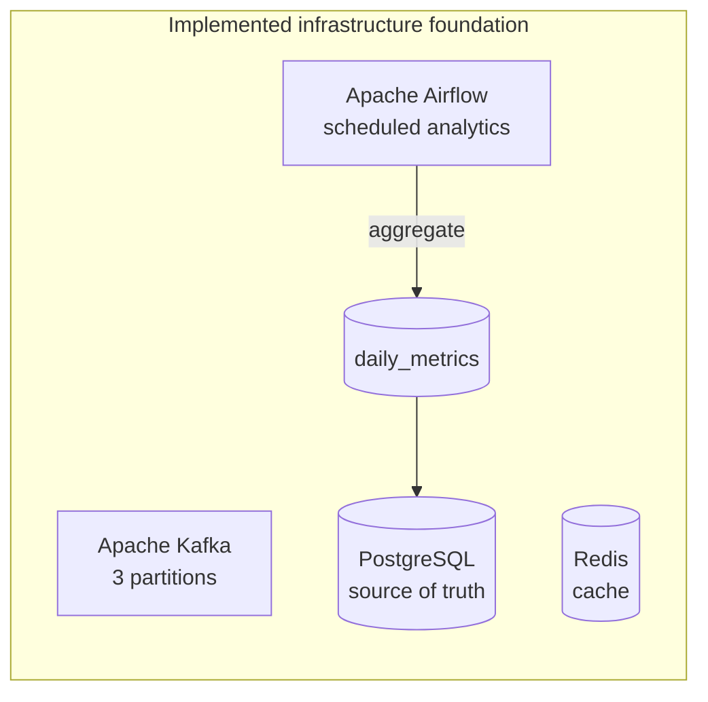
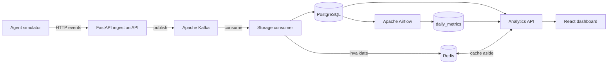

# TraceAI

TraceAI is an event-driven observability platform for simulated AI-agent executions. It captures execution lifecycle events, tool calls, LLM usage, memory access, errors, latency, token consumption, and estimated cost.

This repository is structured as a small data-engineering platform rather than a full AI-agent framework. The project prioritizes a reliable event pipeline, queryable data, scheduled aggregation, caching, and a clear operational dashboard.

## Current architecture

The infrastructure foundation includes PostgreSQL, Apache Kafka in KRaft mode, Redis, and Apache Airflow from the first milestone.



The final intended flow is:



## Repository structure

```text
traceai/
├── airflow/              Airflow image and scheduled analytics DAGs
├── backend/              FastAPI ingestion and analytics service
├── consumer/             Kafka-to-PostgreSQL storage worker
├── database/init/        PostgreSQL schema and bootstrap SQL
├── dashboard/            React and TypeScript dashboard
├── simulator/            Repeatable synthetic workload generator
├── docker-compose.yml    Local multi-service environment
└── README.md             Architecture, setup, and operating guide
```

## Foundation services

| Service | Local address | Responsibility |
|---|---|---|
| PostgreSQL | `localhost:5432` | Persistent event and analytical records |
| Kafka | `localhost:9092` | Buffered `trace-events` stream |
| Redis | `localhost:6379` | Cache-aside analytics storage |
| Airflow | [localhost:8080](http://localhost:8080) | Scheduled daily aggregation |

## Start the infrastructure

1. Copy `.env.example` to `.env` if you want to override development defaults.
2. Start the foundation services:

```powershell
docker compose up -d postgres kafka kafka-init redis airflow
```

3. Inspect health:

```powershell
docker compose ps
```

The default Airflow development login is `admin` / `admin`. Change all example credentials outside a local classroom environment.

## Data-model decisions

- PostgreSQL is the source of truth; Redis never owns historical data.
- Kafka messages use `execution_id` as their key so one execution remains ordered within a partition.
- `processed_events.event_id` provides consumer idempotency when Kafka redelivers a message.
- Derived values such as total tokens are calculated instead of duplicated.
- The MVP records memory access telemetry without implementing semantic vector search.
- Airflow has a separate metadata database to keep orchestration state out of TraceAI's application schema.

## Development status

The infrastructure and relational model are implemented. Application services, the simulator, scheduled DAG, dashboard, and verification are developed in subsequent commits so each architectural decision remains reviewable.

