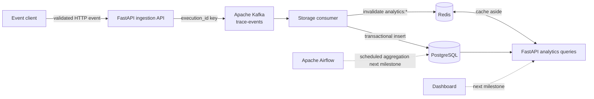
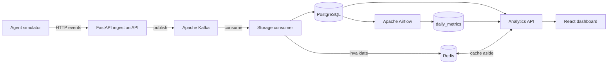

# TraceAI

TraceAI is an event-driven observability platform for simulated AI-agent executions. It captures execution lifecycle events, tool calls, LLM usage, memory access, errors, latency, token consumption, and estimated cost.

This repository is a focused data-engineering platform rather than a full AI-agent framework. PostgreSQL, Kafka, Redis, and Airflow are first-class services from the foundation onward.

## Current architecture

The event ingestion and storage path is implemented. FastAPI validates the shared event contract and publishes accepted events to Kafka. The consumer writes them transactionally to PostgreSQL and invalidates cached analytics after committed writes.



The final intended flow is:



## Repository structure

```text
traceai/
├── airflow/              Airflow image and scheduled analytics DAGs
├── backend/              FastAPI ingestion and analytics service
├── consumer/             Kafka-to-PostgreSQL storage worker
├── database/init/        PostgreSQL schema and bootstrap SQL
├── dashboard/            React and TypeScript dashboard
├── shared/               Versioned event contract used by Python services
├── simulator/            Repeatable synthetic workload generator
├── tests/                Contract and service tests
├── docker-compose.yml    Local multi-service environment
└── README.md             Architecture, setup, and operating guide
```

## Services

| Service | Local address | Responsibility |
|---|---|---|
| PostgreSQL | `localhost:5432` | Persistent event and analytical records |
| Kafka | `localhost:9092` | Buffered `trace-events` stream |
| Redis | `localhost:6379` | Cache-aside analytics storage |
| Airflow | [localhost:8080](http://localhost:8080) | Scheduled daily aggregation |
| TraceAI API | [localhost:8000/docs](http://localhost:8000/docs) | Event ingestion and cached analytics |

## Start the current platform

1. Copy `.env.example` to `.env` if you want to override development defaults.
2. Start the data platform and application services:

```powershell
docker compose up -d --build postgres kafka kafka-init redis backend consumer airflow
```

3. Inspect health:

```powershell
docker compose ps
```

The default Airflow development login is `admin` / `admin`. Change all example credentials outside a local classroom environment.

## API surface

| Method | Path | Purpose |
|---|---|---|
| `POST` | `/api/v1/events` | Validate and enqueue one telemetry event |
| `GET` | `/api/v1/analytics/summary` | Execution, latency, token, cost, and memory totals |
| `GET` | `/api/v1/analytics/tools` | Tool latency, p95, call count, and success rate |
| `GET` | `/api/v1/analytics/agents` | Execution and failure metrics by agent |
| `GET` | `/api/v1/analytics/tokens` | Daily token and cost series |
| `GET` | `/api/v1/analytics/memory` | Memory access frequency and retrieval latency |
| `GET` | `/api/v1/executions/recent` | Most recent execution records |

OpenAPI documentation is available at [localhost:8000/docs](http://localhost:8000/docs).

## Data-model and delivery decisions

- PostgreSQL is the source of truth; Redis never owns historical data.
- Kafka messages use `execution_id` as their key so one execution remains ordered within a partition.
- `processed_events.event_id` provides consumer idempotency when Kafka redelivers a message.
- The consumer disables auto-commit and commits an offset only after the database transaction succeeds.
- Redis keys are invalidated after committed writes and repopulated through cache-aside reads.
- Derived values such as total tokens are calculated instead of duplicated.
- The MVP records memory access telemetry without implementing semantic vector search.
- Airflow has a separate metadata database to keep orchestration state out of TraceAI's application schema.

## Development status

The infrastructure, shared event contract, ingestion API, Kafka consumer, persistent data model, cache-aside analytics API, and contract tests are implemented. The workload simulator, Airflow DAG, dashboard, and end-to-end verification follow in subsequent commits.

